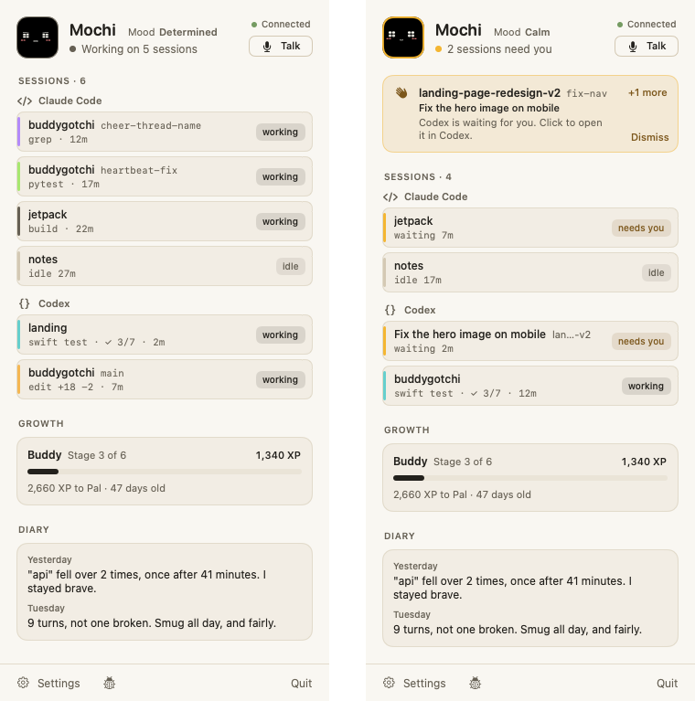

<p align="center">
  
</p>

<h1 align="center">Boop</h1>

<p align="center">
  <b>A little creature for your desk that keeps an eye on your AI coding agents.</b>
</p>

<p align="center">
  
  
  
  
</p>

You've got three Claude sessions and two Codex threads going, and one of
them has been waiting on you for ten minutes. Boop noticed.

- 💤 **Naps** while no agent is open.
- ⌨️ **Works along** while they work: tests, the terminal, planning.
- 🟧 **Lights up amber** and knocks when one needs your approval, and says who.
- 🏆 **Celebrates** a finish that earns it, and grumbles at a failed test (never at you).
- 📦 **Counts who's done** under its face, and its button hands you the next one: whoever needs you, then the agent that finished last, at its thread on the Mac.
- 👉 **Pokes back** when you tap it, and answers when you hold its button and talk.
- 📔 **Keeps a diary**, a line a day about the one before, and dresses for the day: coffee in the morning, a nightcap at night, a costume on Halloween, a party hat on its milestone days.

It has moods of its own, and there's no reset button. It only watches:
it never approves, denies or blocks anything an agent does.

> **Would you like a ready-made Boop?** The software is free and stays MIT.
> If you'd rather not flash a board yourself,
> [let us know →](https://tally.so/r/ZjprM5?src=readme)

<p align="center">
  
</p>

A menu-bar app on your Mac does the thinking, and a cheap ESP32 board
with a screen is the body:

<p align="center">
  <picture>
    <source media="(prefers-color-scheme: dark)" srcset="documentation/media/popover-dark.png">
    
  </picture>
</p>

## Get started

### What you need

| You need | Why |
| --- | --- |
| 💻 **A Mac** | macOS 15 or later, with Command Line Tools 26 or later (`xcode-select --install`): Swift 6.2 and the macOS 26 SDK |
| 🐍 **A newer Python** | For flashing the board, unless you already have PlatformIO's `pio`: `brew install python` ([why](firmware/README.md#build-and-flash)). PlatformIO installs itself |
| 🟨 **A board** | One of the two below, and a USB cable that carries data |
| 🔑 **A Jev key** | Optional. [Jev](https://docs.typesafe.ai/api) is TypeSafe's small hosted model, and it's what picks Boop's reactions. It needs a key from TypeSafe, which may cost money. Without one, Boop still shows what your agents are doing and when you're needed, but doesn't react or celebrate. Add it in Boop's Settings |

### Supported boards

| Board | Screen | Touch | Connects over |
| --- | --- | --- | --- |
| **Cheap Yellow Display**<br>MicroTech MTR024QV01A-V1 | 2.4" IPS, 320×240 | Resistive | Bluetooth, USB |
| **Waveshare ESP32-S3-Touch-AMOLED-2.06** | 2.06" AMOLED, 410×502 | Capacitive | Bluetooth, USB |

Pins, parts and quirks are in [the firmware's README](firmware/README.md).

### Three steps

Clone this repository with its submodules, and run everything from its
folder:

```sh
git clone --recurse-submodules https://github.com/Mellow-Machines-Lab/buddygotchi.git && cd buddygotchi
```

1. **Flash it.** Plug the board in over USB and run `make flash`. It
   works out which board it is. The first time, it installs PlatformIO
   and the ESP32 toolchain inside the checkout, which takes a few
   minutes; a `pio` already on your `PATH` is used instead.
2. **Run it.** From your own terminal, run `make bundle`, then
   `open .build/Boop.app`. The first build takes a few minutes, then
   Boop says hello in a window of its own.
3. **Meet Boop.** It walks you through what it does, gets a name and a
   nature (sweet or cheeky), finds its body on your desk (tap its screen
   when it asks), shows you how to use it, and connects your agents.
   Then it lives in the menu bar. Restart open agent sessions so they
   pick up Boop's hooks.

Then tap the screen to poke it. Press BOOT while an agent waits for you
and it opens that agent on the Mac; with nobody waiting, BOOT pokes it
too.

**Which character.** A clone runs Boop, the repository's own character:
the gel slime on the AMOLED board, and a pixel face on the CYD. Pixel is
the plain example character, for the CYD only. To run it, put `pixel` in
a file named `.character` at the repository's root before you flash and
run ([characters/CHARACTER.md](characters/CHARACTER.md) §2).

### Everyday commands

| To | Run |
| --- | --- |
| Flash the firmware (over USB) | `make flash` |
| Build `Boop.app`, to open from Finder or put in Applications | `make bundle` (then `open .build/Boop.app`) |
| Work on Boop: the debug app, with the simulator, the studio and the live dashboard beside it | `make dev` ([CONTRIBUTING.md](CONTRIBUTING.md)) |

Start `make dev` from your own terminal: macOS stops anything that uses
Bluetooth from an editor's or an agent's shell. Debugging and the brain's
evals are in [CONTRIBUTING.md](CONTRIBUTING.md).

## What leaves your Mac

Nothing, unless you add a Jev key. With one, each time Boop thinks, it
sends TypeSafe a short text: what's been happening, in lines like
`claude started turn 1 on "landing".`, and Boop's personality and mood.
Your prompts don't: Boop reads each one on your Mac, after taking out
anything that looks like a key or a password, and sends only what it
made of it (a fix, frustrated, in a sentence) and up to three short
phrases of yours, such as "still broken". The agent's last message is
read the same way, and only what Boop made of it goes (it's done, it
couldn't finish, it asks you something, apologetic) with up to three
of its phrases, such as "absolutely right". On macOS 26 with Apple
Intelligence on, Apple Intelligence reads them; otherwise Boop only
counts them (how long, whether you said Boop's name, a "please", a
"sorry"). One thing in your own words goes, cut to 300 characters:
what you say to Boop when you hold its button. Your files, commands and
tool output never do.

## Uninstall

In Boop's Settings, under App, choose **Uninstall…**. Boop takes its
hooks out of Claude Code and Codex (unless another app that listens to
them is installed, which keeps them), stops opening at login, moves
`Boop.app` to the Trash and quits. Its memory stays in
`~/Library/Application Support/Boop`, so a Boop installed again
remembers; delete that folder to forget it too.

Without the app, from this folder, this takes the hooks out:

```sh
.build/debug/boopdev hooks remove --home ~
```

Run `swift build --product boopdev` first if `.build/` is gone.

## Built from open packages

Boop stands on small packages that know nothing about it. Each one is
useful on its own:

| | Package | What it does | How it works |
| --- | --- | --- | --- |
| 🪝 | [agent-hooks](agent-hooks/README.md) ([repo](https://github.com/Mellow-Machines-Lab/AgentHooks)) | Tells you what every coding agent is doing, and which one needs you | [ARCHITECTURE.md](agent-hooks/ARCHITECTURE.md) |
| 🧠 | [MellowHarness](mellowharness/README.md) ([repo](https://github.com/Mellow-Machines-Lab/MellowHarness)) | Gives anything a personality with Markdown and multiple choice | [ARCHITECTURE.md](mellowharness/ARCHITECTURE.md) |
| 📡 | [LinkKit](linkkit/README.md) (in this repository for now) | Links your Mac app to a little gadget, over Bluetooth or USB | [ARCHITECTURE.md](linkkit/ARCHITECTURE.md) |

## Learn more

- **[architecture.html](https://htmlpreview.github.io/?https://github.com/Mellow-Machines-Lab/buddygotchi/blob/main/documentation/architecture.html)**:
  how Boop fits together, following one finished turn through every piece.
- **[characters/CHARACTER.md](characters/CHARACTER.md)**: what a
  character pack holds, and how to make your own.
- **[characters/DEMOS.md](characters/DEMOS.md)**: how to write a demo
  and play it in the browser, on a board or with a real agent.
