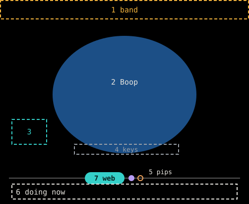
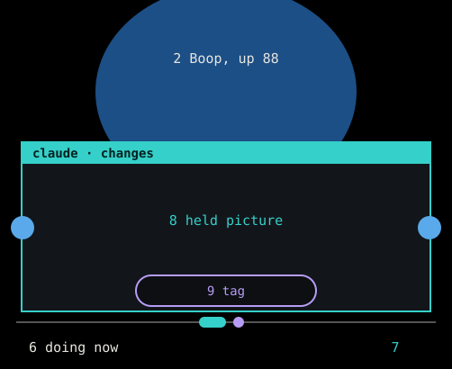
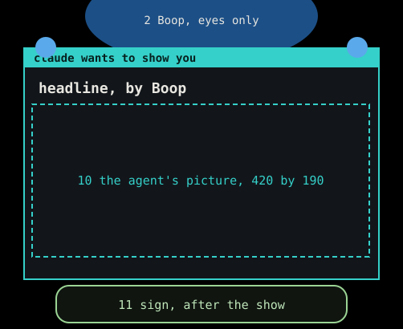

# The screen guide

Updated 2026-11-25. What takes which space on the gel's 502 by 410 screen,
how large it is, what shape it has, and what wins when two things want the
same place. The why is in [theory.md](theory.md); each case moves in
[animations.html](animations.html).

Positions are in pixels from the top left. They come from the sketch in
`animations.html`, not from the firmware. When the firmware settles one,
correct it here.

## Words

This guide uses the repo's words (CLAUDE.md, Words).

## The map

Three layouts cover every case. The bottom of the screen never moves: the
line with the pips, and the strip under it. The bottom left always says what
the agent does now.

| Base: idle and plain work | Held picture | Show, then low sign |
| --- | --- | --- |
|  |  |  |

## Each element

| # | Element | Place and size | Its one job | Whose | How it changes |
| --- | --- | --- | --- | --- | --- |
| 1 | Band | 0,0 · 502×38 | Something you must act on: needs you, listening | For you | Drops in. Needs you also puts an amber rim on the whole screen |
| 2 | Boop | 106,52 · 290×250 | Pose: who it works for. Rhythm and gaze: you. Face: Boop | Boop | Moves all the time. Rises 88 for a held picture, 196 for a show |
| 3 | Monitor | 24,240 · 70×50 | The kind of work: search, edit, run, helpers. Red for a failure | Agent | In place. Frame in the lane colour. Dark when idle |
| 4 | Keys | 150,290 · 210×20 | Where the hands go when typing, yours or the agent's | Boop | In place |
| 5 | Line and pips | y 352–366, centred | Every agent, and which one you see. The swipe hint. Pull up for the drawer | Agents | The long pip slides. A pip pulses when its agent wants you |
| 6 | Doing now | 24,368 · left, 22 px | This call, as a verb and its object. Clay for a failure. "your turn" after a chat turn | Agent | In place, at every call |
| 7 | Agent name | Right end of the strip, 14 px chip | Which agent you see, in its lane colour | Agent | In place, on a switch |
| 8 | Held picture | 24,158 · 454×188 | The work as a live picture | Agent | Rises from below. Put down when its data stops |
| 9 | Pill | Centred, y 306 · 34 high | News from an agent you are not watching | For you | Rises, stays about 4 s, a tap goes there |
| 10 | Show | 30,60 · 442×288. The agent's picture is 420×190 inside it | A result as a picture | For you | Rises, stays 30 s, folds into the low sign |
| 11 | Low sign | 70,352 · 362×46 | A finished turn: green for done, clay for failed. A tap opens it. What it earned rides at its right end as a chip, `+5 XP`. Also a ship or a fix with its chip, the ring full (`100 XP today, day 12`, gold, a ring mark) and last week's league place (gold, a medal) | For you | Takes the strip's place |

The drawer and an ask keep their places of today: the drawer comes up from
the strip to about y 150, and an ask sits over the strip with its two
answers.

## What shows in each state

One picture-size thing at a time: a held picture, or a show, or neither.

| State | Band | Boop | Monitor | Held picture | Strip | Going with you |
| --- | --- | --- | --- | --- | --- | --- |
| Idle | No | Its own look; full size with you | Dark | No | The counts in words, or "your turn" | Full |
| Working, plain | No | Work pose | Icon | No | Doing now | Light |
| Working, with a picture | No | Up, holding | Hidden | Yes | Doing now | Light; the picture bobs |
| A failure lands | No | Flinch | Red, 2.5 s | Stays | Clay word | Light |
| A turn finished | No | Hop or flinch, then to you | Dark | Replaced by a show | Low sign in its place | Light |
| Needs you | Amber | Knocks on the glass; climbs if nobody comes | Stays | Put down | What it asks | Off |
| Listening | White | To you | Stays | Stays | Stays | Off |
| On a call | No | Still and silent | Goes on | Stays, no bob | Goes on | Off |
| Face down | Only needs you | Dimmed | Dimmed | Dimmed | Dimmed | Off |
| Asleep | No | Dim, eyes closed | Dark | No | Empty | Off |
| No Mac | No | Resting, then asleep | Dark | No | "no Mac" | Off |

## Hands, the glass and turning round

Boop has one pair of hands, gel stubs that are part of its body. They bud
out of the dome when they act and sink back in; at rest none shows. Each
is a ball, an open palm (at most three small fingertips) or a fist, and
never grows fingers. The same two hands type on the keys, grip a card or
a sign by its sides, hold the low sign by its top corners, cup an ear
while you speak, hang over the drawer's edge, and act in a move: a palm on
the glass, a fist knocking. Each frame one owner has each hand: a move
first, then a sign, a card, the low sign, the ear, the keys.

The glass is the screen, a pane Boop lives behind. Up at the glass the
whole body is bigger, 1.15 at most. What touches it, a hand, a cheek, the
forehead or the whole front, goes flat and shows a pale patch, like a hand
on a window. A hit on it adds a ring and a small shake.

| Move | When | What you see |
| --- | --- | --- |
| Palm up | The `win` skit's invite | A hop, then one palm flat on the glass beside its right eye, about 85 px across, the glow round it and "tap" under it. A tap: a ring, a hop and a wobble. No tap: it looks at its palm, lowers it and shrugs with both hands |
| The lean | The `back` skit's invite | It perks up and rests its cheek on the glass, the patch glowing, "pet" beside it. A stroke: a fast small purr, eyes shut |
| The knock | Needs you | A fist knocks twice on the glass at the body's upper right. If nobody comes it climbs: a bigger fist, three knocks; both fists by turns; then its forehead on the glass, palms sliding down |
| The flop | A check passes after failing: the `fix` skit's Moment names it (`clip`) | Flat against the glass, both palms on it, sliding down, then peels off |
| The back | The `upset` skit's invite | A stomp, then it turns its back, "pet" under the glow on its back. Now and then it looks over its shoulder, one eye at the rim in side-eye, and turns away again. A stroke: a sigh as it comes round. No stroke: a huff, and it comes round by itself |
| The spin | The high five | All the way round during its hop |

Turning round: the dome is round, so turning moves only the face across it, and
the eye nearer the rim narrows on its own as it goes round. Turned half
way, one eye shows at the rim; all the way, the face is gone: the back.
The outline and the dome's light never move.

The palm and the knock stay above the strip. Only the palm's glow asks
for your touch, and only while nothing else does.

## Who wins the space

1. **Needs you.** The band and the amber rim. It covers a show and puts a
   held picture down.
2. **Listening.** The band only. Nothing below it moves.
3. **A show.** It takes the screen above the strip once, for the agent that
   finished, then Boop returns to the agent you watched. It waits while 1 or
   2 is up.
4. **A low sign.** It takes the strip's place, for the agent you watch.
5. **A pill.** For any other agent. Never more than one; a second one waits.
6. **Your swipe.** Boop keeps your agent until it goes idle or you swipe
   again. On a switch the strip's row and the card slide in from the side
   you swiped toward (0.32 s) while Boop stays, and the monitor's frame
   takes the new agent's colour. When the set of agents changes, two faint
   arrows at the strip's ends say there are others to swipe to.

Every agent has its own colour from when Boop first sees it, a resting one
too, and keeps it across turns: its pip, its chip, the monitor's frame, its
card and its row in the drawer and the popover all wear it.
7. **A held picture.** An agent with a picture beats an agent with plain
   work.
8. **Plain work.** The monitor and the strip only.

With several results at once, each show takes the screen in the order the
turns finished, at least 8 s each.

## How a turn ends

| Ending | Boop | Then |
| --- | --- | --- |
| Done, with a show | Hops | The show for 30 s, then a green low sign |
| Done, no show | Hops | A green low sign |
| Failed | Flinches; the monitor is red | A show if the agent sent one, then a clay low sign. The low sign is the only card for a failure |
| A chat turn | Turns to you. No hop | "your turn" in the strip. No sign, no glow |
| Any of these in an agent you do not watch | Looks at its pip | A show still takes the screen once. Everything else is a pill, and its pip pulses |

## Held pictures

A held picture is fed by what the Mac already hears through the hooks, so it
is live and costs the agent nothing. It shows only while its data changes.

| Picture | Shows | Fed by | Shown while |
| --- | --- | --- | --- |
| Plan | Step blocks, the current step's name, a ring for the agent's own time guess | The agent's to-do | The agent has a to-do and nothing below fits |
| Changes | A row for each file: a green and a red bar, "+48 −15" | Edit and write calls on the project's files (not /tmp) | The agent edits, once the turn has changed 10 lines or 2 files |
| Helpers | A lane for each helper, working or done | Helper start and stop | Helpers run |

Two more need numbers from the agent, so they come later: a meter (n of m,
with a count of bad ones) and one number with its trend.

## The show

Boop draws the frame, and the agent draws the inside. The title bar and the
headline are Boop's, in Boop's font. The agent gets the 420 by 190 picture.

An agent sends one of:

- `svg`: a small SVG on `viewBox="0 0 420 190"`.
- `image`: an absolute path to a PNG it made, such as a screenshot.

Rules the Mac checks before a show goes to the board:

- One idea. At most 16 words. Text at least 14 px, lines at least 3 px.
- Only these colours: ink `#e8e6e0`, dim `#9aa0a8`, good `#5fae5a`, bad
  `#f08a6c`, not checked `#f0b56c`, and `currentColor`, which is the agent's
  lane colour.
- Shapes, lines and text. No gradients, filters, images, scripts or outside
  links. At most 4 kB. The background is already dark.
- A headline of at most 28 characters that states the conclusion.

A picture that fails a rule goes back to the agent with what is wrong. If no
good picture comes, the turn ends with the low sign alone.

Built so far: the tool, its check (`Show.problems`) and the popover's card
(`ShowCard`), and the board (`Core.boardShow`, the gel's `paintShow`): the
Mac draws the picture at the board's pixels in 16 colours (`ShowPicture`)
and sends it as a blob (linkkit's SPEC.md §3), the headline showing
alone until it arrives. As built, the finish's hop and low sign play
first and the show comes up after them, held 30 s from the turn's end.

The draft of the tool's instructions:

```text
show: put one picture on the person's desk companion when your turn made,
found or decided something. Call it once, right before your final message,
in every turn that used tools. Skip it only for a plain chat answer.

headline: the conclusion in a few plain words, at most 28 characters.
  "search is 2.1x faster", not "performance results".
svg: one picture that proves the headline. Or image: an absolute path to a
  PNG you made, such as a screenshot.
link: optional. A URL or an absolute path to open on tap.

Show the bad news too: what failed, what you did not check.
Pick the form that fits: bars for a before and after, a row of boxes for a
chain or a flow, two frames for a visual change, a short check list for
done and not done.
```

## Shape and light

Shape says whose a thing is. Light says whether it is for you.

| Look | Means | Used by |
| --- | --- | --- |
| Square, 3 px corners, lane colour, flat | The agent's. You can ignore it | Held picture, monitor |
| Square, lane colour, glowing | The agent's, and for you | Show |
| Round, 16 px corners, glowing | Boop's voice to you | Low sign, pill, ask |
| Amber | Needs you, and nothing else | Band, rim |

## Type

One mono face. Nothing under 14 px.

| Where | Size | Weight | Limit |
| --- | --- | --- | --- |
| Held picture, main line | 26 px | Bold | About 18 characters |
| Show headline | 23 px | Bold | 28 characters |
| Strip, doing now | 22 px | Medium | 24 characters |
| Picture rows, low sign, band | 18–19 px | Bold | Low sign: 26 characters |
| Picture small line, pill | 16–17 px | Regular; the pill bold | |
| Title bars, name chip, text in a show's picture | 14–15 px | Bold | A show's picture: 16 words |

## Colour

- A lane colour belongs to one agent everywhere: its pip, its monitor frame,
  its picture, its name chip, its pill.
- Good, bad and not checked are for outcomes. They never mark an agent.
- Amber means needs you. Keep lane colours away from it.

## Motion

| Motion | Means | Used by | Time |
| --- | --- | --- | --- |
| Change in place | The work goes on | Monitor, strip, pips, bars in a picture | At once, to 0.5 s |
| Rise from below | Something arrives | Held picture, show, pill, low sign | 0.3–0.4 s |
| Slide sideways | You changed agent | Monitor, picture, strip. Boop stays | 0.22 s out, 0.22 s in |
| Drop from the top | You must act, or you talk to Boop | Band | 0.3 s |
| Sway, lean, bob | You, at the Mac | Boop's body, a held picture | Your speed, or a 1.6 s beat |
| Hop, flinch | Boop's feeling about an outcome | Boop's body | 0.5–1.2 s, once |

Under all of Boop's own moves the gel runs one motion layer (motion V2,
the slime's `CONTINUITY.md`, The motion layer): the body stretches tall
as it moves fast and goes flat as it lands, overshoots a stop and
settles, its crown drags behind a slide, the hands arrive and leave late,
and the face trails the body by a few px and catches up. Until V2 the face
never moved on the body by itself; now it does, on purpose, only while
the body moves, and it's still again at rest. Each rule has a switch
(`dbg.motion`) to judge it on the board.

## Meme faces

Six faces past the 18, each with one body move that sells it, in the
gel's face language: solid dark eyes, no whites, one small mouth, the
lids and the gaze doing the acting. The board draws them; no rule or brain
on the Mac picks one yet, but the back wears side-eye.

| Face | Looks | Its move |
| --- | --- | --- |
| Deadpan | Flat lids half down, a flat mouth | One slow blink, nothing else |
| Side-eye | A flat lid across each eye, the eye pressed to one end | The body stays; only the eyes go |
| Squint | One eye a slit, the other under a flat lid, a wobbly mouth | It comes to the glass to doubt you |
| Smug | Half lids, a glance aside, a cat's w, pink cheeks | A tilt of the whole body, chin up |
| Silent scream | Tall eyes, a tall open oval mouth | Tall and shaking, palms on its cheeks, no sound |
| Faint | Crosses for eyes, a wobbly mouth | It tips over and melts |

## Going with you

Each is a rhythm and a gaze. Full size is for idle. Light size rides on any
work pose and on a held picture.

| You | Signal, never content | Full size, idle | Light size, at work |
| --- | --- | --- | --- |
| Type | `typing`, `typingfast` | Keyboard out, Boop types with you, and a key's tick bursts beside the hand that taps | The pose sways at your speed, and the same ticks burst beside it |
| Speak | Another app records and no camera runs | One hand cups an ear, Boop leans in, rings pulse by the ear | The same, in the pose |
| Scroll | `scrolling` | Reads along, a page beside it on the Mac's side, its lines scrolling up as you scroll | The page beside the pose |
| Move the pointer | `ptr` | Eyes follow | Eyes follow |
| Play music | `music` | Headphones on; grooves, notes rising from them; rests with them still on | Headphones on, notes in the groove |
| Watch a video | `video` | Watches a small screen beside it, a play mark on it; its light on Boop, a new colour every few seconds | The screen and its light |
| Take a call | A camera runs | Still and silent, a muted mic by its ear | The same, in the pose |

One rhythm at a time. If you type and speak together, speaking wins. Each
has a mark on or beside the body that reads from a chair (the ticks, the
rings, the headphones, the page, the screen, the muted mic), since a sway
alone is too small to see. A sign held up hides the ticks. The page and
the screen stand beside Boop, so they wait while its hands type along or a
card is held; a call shows the muted mic and nothing else.

## The strip's words

The strip must always make sense to someone who is not watching the
terminal. It is a verb and what it is done to.

| The call | Say | Never |
| --- | --- | --- |
| A search | "searching TODO": the pattern | "grep", "rg" |
| A read | "reading Core.swift": the file's name, no path | "Core.swift", "read" |
| An edit | "editing Core.swift +12": the name and the lines added | A bare file name |
| A build or compile | "building Boop", "compiling Core.swift" | The command line |
| Tests | "running the tests" | "make -C internal test" |
| Git | "committing 3 files", "pushing to main" | "git" |
| An install | "installing 4 packages" | "npm" |
| Another command | "running" and the program's name: "running ffmpeg" | Flags and paths |
| The web | "searching" or "reading" and the subject or site | "web", a URL |
| A helper | "sending a helper" | "Task", "subagent" |
| A tool Boop does not know | "using" and the tool's name, spaced as words | An inside name such as `mcp__x__y` |
| No call for a while | "thinking" | An empty strip |
| A long call | The same phrase, then the time: "building Boop · 2 min" | A frozen phrase |
| A failure | "failed:" and what, in clay: "failed: 2 tests" | A code |

Rules:

- At most 24 characters. Cut at a word, and cut the object before the verb.
- A phrase stays at least 1 s. When calls come faster, show the newest and
  skip the rest. The words must never flicker.
- When only a number changes, change the number in place.
- Every place that shows the work uses these same phrases: the strip, a
  word that comes forward, the drawer's rows. A bare word such as "grep" or
  "read" appears nowhere.

Built in `WorkStream`: `doing` and `phrase` for the words, `Lane.shown` for
the hold, the time and "thinking", and `word` for what comes forward. A
command Boop knows by name is in `WorkStream.commandVerbs`; add one there.

## Energy

One dial with three levels. It shows on the eyelids and the tempo, in idle
and at work.

| Level | When | Eyelids | Tempo | Also |
| --- | --- | --- | --- | --- |
| Bright | The first hour after the day's first hello | Wide | Quick sway | The first hello is a stretch and a yawn |
| Normal | The day | Normal | Normal | |
| Tired | Night (the `night` tag), or `tier3`: 15 min and more of work without a rest | Heavy: about half height, flat on top | Slow: about half speed | A yawn now and then. At work, a droop between calls. A little dimmer |

Energy never changes the monitor, the strip or a held picture, and it never
slows a reaction to you.

The Mac decides the level and sends it as `state.energy`, so the board and
the Mac app always agree (`Core.energy`; the board's `render::Energy`).
Built: the lids, bright's wider eyes, the idle tempo (70% tired, 115%
bright), a stretch at the day's first hello, and a yawn dealt when tired.
Not built yet: the droop between calls at work. The popover says it in a few warm words under Boop's face when the
level is not normal, such as "Boop's getting sleepy."

## Small details: keep, fold or cut

| Detail | Do | Why |
| --- | --- | --- |
| Nightcap | Cut | Energy says the time of day |
| Tiers: looks by time worked or idle | Fold into energy | One dial, not two systems |
| Busy and frantic typing | Cut | The tempo is yours |
| The "copied" pose | Cut | Tiny, and it says nothing |
| Music and video | Keep | They are you, on your channel |
| A special day | Keep as one sign at the hello | No costume |
| Zs, the hello, the bye | Keep | Clear and rare |

A new detail must pass the three tests in [theory.md](theory.md).

## Before you add something

- Name its element in the table above. If none fits, it probably should not
  ship.
- If you can ignore it and lose nothing, it gets no rise, no rim and no
  glow.
- It must not say what another element already says. The monitor says the
  kind, the strip says the call, a held picture shows progress.
- It must read from a chair on the real board.
- It must still let you type, speak and touch. Only needs you, listening
  and sleep turn those off.
