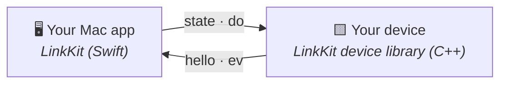
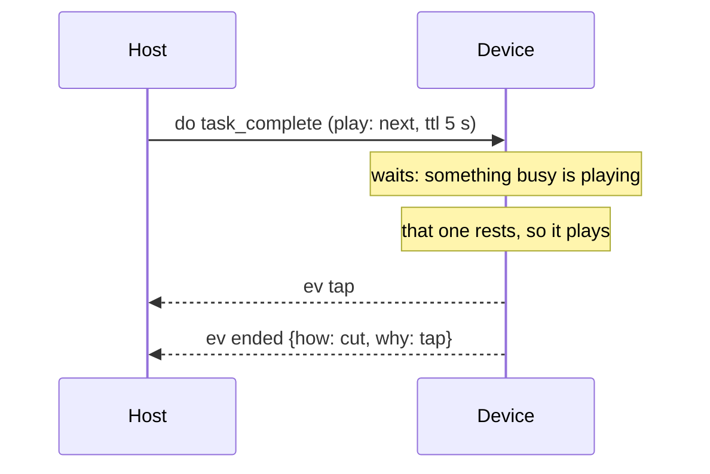

# How LinkKit works

Updated 2026-10-24. The tour of LinkKit: the four messages, the queue, and
each side's library. [README.md](README.md) is the short version;
[SPEC.md](SPEC.md) has every rule exactly.



## The four messages

Each is one line of JSON of at most 512 bytes, the same over Bluetooth and
USB:

| Message | Way | What |
| --- | --- | --- |
| `state` | host → device | How things are now, the app's own map, sent whole on every change and every 10 s |
| `do` | host → device | Please play this: a name the device plays, how it joins the queue (`play`), and the app's `args`. Exactly one `ended` comes back |
| `hello` | device → host | Who it is (`app`, `id`, `fw`), the protocol's version (`kit`) and the names it plays (`does`). The host asks for it with a bare `{"t":"hello"}`, first on every link-up |
| `ev` | device → host | Something happened: a tap, a held button, and how each `do` ended (`ended`) |

```json
{"t":"state","base":"working","mood":"calm","busy":1,"vol":6}
{"t":"do","id":44,"name":"task_complete","play":"next","ttl":5000,"args":{"outcome":"success"}}
{"t":"hello","kit":1,"app":"boop","id":"b00p-54fe","fw":"1.4.0","boot":"5d0e19a3","does":["react","starting","listening"],"voice":"1aace295d219"}
{"t":"ev","kind":"tap","did":"poked"}
{"t":"ev","kind":"ended","data":{"id":44,"how":"cut","why":"tap"}}
```

The kit owns a few field names and the app owns the rest: all of
`state`, a `do`'s `args`, an `ev`'s kinds and `data`, and any other field
in `hello`. Tools also send `dbg.*` messages over USB (SPEC.md §7).

## The queue, in five points

The device, not the host, decides when each `do` plays. Here a
celebration waits in the queue behind a busy animation, and a tap cuts
it short:



1. The queue's head is the `do` playing; the rest wait behind it in
   order of arrival. The one playing is busy (don't cut me) or resting
   (the part that matters is over, and anything may replace it).
2. `now` plays at once, cutting a busy one; `next` waits in the queue,
   up to its `ttl` (5 s by default); `if_free` plays only if nothing busy
   is playing.
3. The device's app says when the one playing rests or ends, what it
   refuses, and what cuts it (a tap, a button).
4. Every `do` gets exactly one `ended`: `done`, `cut` or `skipped`, with
   a short word why (`now`, `late`, `busy`, `tap`).
5. The host never times what the device plays: it sends at once and
   waits for the `ended`, giving up only at the `ttl` plus 60 s.

## The host, in Swift

It builds from source with Swift 6 (Xcode or the Command Line Tools) on
macOS 13 or later, on Foundation and CoreBluetooth alone:

```swift
// Package.swift
.package(path: "../linkkit"),
// and in a target's dependencies:
.product(name: "LinkKit", package: "linkkit"),
```

A `DeviceLink` keeps the device's picture true with `state`, sends each
`do` and hands its end to a completion called exactly once, and passes on
every other `ev`. USB writes share one [deadline per message](SPEC.md#8-transport),
so even a bridge reading slowly cannot hold up the app indefinitely.
It runs on one dispatch queue of yours: the transport calls back
on its own thread, so hop to the queue, and tick the link about once a
second for the keepalive and the give-ups. This drives the lamp from the
device library's example (below) through the USB bridge's socket, with
the board plugged in and `swift run linkkit-bridge --socket /tmp/lamp.sock`
running beside it:

```swift
import Foundation
import LinkKit

/// Drives a lamp over its USB bridge: its level, a blink, its button.
final class LampHost: @unchecked Sendable {
    let queue = DispatchQueue(label: "lamp")  // the link's one dispatch queue
    let link = DeviceLink(app: "lamp", transport: SocketTransport(path: "/tmp/lamp.sock"), log: { print($0) })
    var keep: [Any] = []

    func now() -> Int64 { Int64(Date().timeIntervalSince1970 * 1000) }

    func start() {
        link.onEvent = { ev in
            if ev.kind == "press" { print("pressed; the lamp \(ev.did ?? "did nothing")") }
        }
        link.transport?.start(
            onLine: { [self] line in queue.async { [self] in link.receive(line, now: now()) } },
            onConnection: { [self] up in queue.async { [self] in link.connection(up, now: now()) } })
        queue.async { [self] in link.update(state: ["level": 40], now: now()) }
        let tick = DispatchSource.makeTimerSource(queue: queue)
        tick.schedule(deadline: .now() + 1, repeating: 1)
        tick.setEventHandler { [self] in link.tick(now: now()) }
        tick.resume()
        keep = [tick]
    }

    /// Blinks twice once nothing else plays on the lamp, and says how it went.
    func blink() {
        queue.async { [self] in
            link.do("blink", args: ["times": 2], now: now()) { outcome in print("blink:", outcome) }
        }
    }
}
```

- **Ids** start somewhere random each launch and count up, so a `do` an
  earlier launch left on the device can't be mistaken for a new one.
- **Who asked** for each message goes to `onSend` with it, for a debug log:
  the name you pass as `by:` on `do` (`app` when you don't), and `link` for
  the link's own messages, every `state` and its ask for `hello`.
- **A `do` fails at once**, with nothing sent, when there's no link, no
  `hello` yet, the name isn't in `hello.does` or the message would be too
  long; later when the link drops or no `ended` comes in time. The
  completion's `Outcome` says which, in plain words. A `state` too long
  for a message isn't sent either: the last one that fit stands.
- **`hello`** is `link.hello`, the app's own fields among it; `onHello`
  hears a new one. The link asks for it (`{"t":"hello"}`, which the
  device library answers) when the link comes up, and every 10 s until
  it comes, since a device that still counts the host as there (an app
  relaunched within 30 s, or one taking over a Bluetooth link macOS
  kept) doesn't say it unasked. A device whose `kit` or `app` doesn't
  fit still gets `state` but no `do`, its `ev`s are dropped, and
  `link.trouble` says why (`.tooOld`, `.tooNew`, `.otherApp`), with what
  to do about it in its `description`, for your settings screen.
- **Bluetooth:** `BLETransport(prefix: "Lamp")` finds `Lamp-XXXX` on the
  Nordic UART service; `BLETransport(prefix: "Lamp", only: "Lamp-54FE")`
  takes that device alone, so an app with two devices runs two transports,
  one `DeviceLink` each, side by side. `take(only:)` changes that while
  it runs: an app remembering the device it met first, or forgetting it.
  It cuts messages to the write size and keeps a newer
  `state` from queueing behind an old one; it never drops a `do`, and
  gives up a link too stuck to take them. While Bluetooth is off, not
  allowed or missing, its `trouble` says so: a `cause` (`.off`,
  `.notAllowed`, `.unsupported`) for your app to act on, such as opening
  the right settings, and the `words` to show, in your app's name
  (`appName`, the prefix unless you give one). macOS kills a process that
  touches Bluetooth without the right to, so tests, and anything started
  from an agent's shell, use `SocketTransport`. The link isn't paired or
  encrypted, so anyone in range can reach the device (SPEC.md §8).
- **USB:** `linkkit-bridge` owns the board's serial port and shares it on
  a Unix socket, so your app (`SocketTransport`) and your tools can use
  the board at once: `--port` names the port when there's more than one
  USB serial port, `--socket` where to share it (`$TMPDIR/linkkit-bridge.sock` by
  default), `--baud` the board's
  rate (460800 by default). An app can run one itself (`Bridge`), ask
  whether one answers on a socket (`SocketTransport.answers`), and ask
  the board on a free port who it is (`Bridge.hello(on:)`, the bare
  `hello` and the board's answer, or nil).
- **Firmware:** `Flasher` writes images onto an ESP32 or ESP32-S3 over
  its USB serial port through the chip's ROM bootloader, as esptool does:
  DTR and RTS reset it into the bootloader (the S3's own USB and a
  USB-serial chip's auto-reset circuit each take their own sequence),
  each image goes in compressed a kilobyte at a time and is checked
  against the chip's MD5 of it, and EN restarts it into the new firmware.
  Once it's been reset, the board is restarted however the write ends,
  so one that fails partway isn't left in its bootloader.
  Only the images given are written, so the bootloader, partition table
  and settings stay. Given a chip, an app image whose header names the
  other is refused before the board is touched; or `flash(pick:)` asks
  which images to write for the chip the bootloader reports. The port
  must be free: stop the bridge first. `linkkit-flash --chip esp32s3
  --flash-size 16MB 0xe000:boot_app0.bin 0x10000:firmware.bin` does it
  from a terminal.

`Wire` builds and reads the messages themselves, and `JSON` and `JSONObject`
(keys in order) are the app's parts of them.

## The device, in C++

The device's half is in [device/](device/README.md): C++17 on
ArduinoJson, with no Arduino headers in its portable part, so it runs on
a Mac for tests and simulators. Its `Kit` reads the host's messages, keeps
the links, says `hello`, runs the queue, routes `ev` and answers the
`dbg.*` messages; your `App` says what it plays, draws it, and reports
when the `do` playing rests, ends or is cut. Its README has the lamp, whole.
Boop's firmware is another app on it.

## Boop

Boop, the desk creature LinkKit was pulled out of, is one app on it: its
own `state` fields, `do` names, `hello`'s `voice` and taps, on the Mac
and in its firmware.

## Development

```sh
swift test --scratch-path .build/tests
```

The tests use Swift Testing: `LinkKitTests` (framing and chunking, the
Bluetooth outbox and reconnect timing, the socket transport, the bridge
and asking a port's `hello` on a pseudo-terminal, the wire, the
keepalive, `hello` and trouble, ids, exactly one end, the give-up, a
link that drops, and the flasher against a fake bootloader), each naming
the SPEC.md section or the rule it checks. The device half has
its own PlatformIO project for its tests
([device/README.md](device/README.md)). The package depends on nothing
but Foundation and CoreBluetooth, and on nothing outside this folder.
